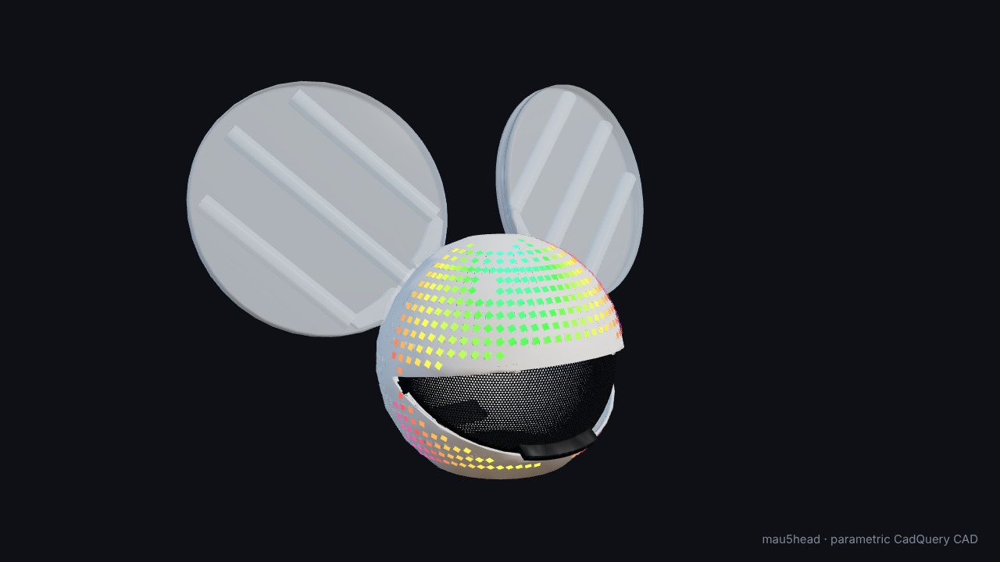

# mau5head

Software for my deadmau5 helmet: 621 addressable pixels on one chain into a
WLED controller -- 398 in the slots of a printed PETG shell and 223 in
the two ears -- driven from a phone with no laptop and no network.

The write-up, with videos of how the LEDs were found and how the shows work, is on
[vortex1.dev](https://vortex1.dev/project.html?p=mau5head-v2), and the
whole effect engine runs in a browser in the
[simulator](https://vortex1.dev/mau5-simulator.html).

## The helmet itself: CAD, build guide, wall mount



The printed parts are parametric CAD in [`cad/`](cad/README.md): one CadQuery script builds
the shell, ears, internal visor, pivots, hard-hat mount and electronics tray as STEP files,
and a second builds a **wall mount** that holds the helmet by its rim and from the centre.

- [`cad/README.md`](cad/README.md): what to print, in what orientation, and the hardware
- [`docs/build-guide.md`](docs/build-guide.md): how it all goes together, step by step
- [`docs/cad-design.md`](docs/cad-design.md): how it was designed and why, with the mistakes
- the film: [`docs/img/cad/mau5head_cad_tour.mp4`](docs/img/cad/mau5head_cad_tour.mp4)

## Five minutes, no helmet needed

```bash
python3 -m pip install numpy pillow matplotlib
python3 test_mau5.py                    # about 140 checks, all offline
python3 mau5web.py --serve              # the simulator, on this machine
python3 mau5offline.py serve            # the phone player, against a fake helmet
python3 mau5doctor.py --offline         # what is set up and what is not
```

Python 3.9 or later.  `ffmpeg` is only needed for the films.  `node` runs the
checks of the phone player's JavaScript, its power guard among them; without
it they cannot run, and the test summary says so.

## What is where

```
the map
  mau5slots.py      builds data/cal/pixel_map.csv: every LED in a CAD slot or
                    ear tube, with two camera views deciding which
  mau5map.py        reads the map, applies hand corrections from adjust.json
  mau5locate.py     measures one camera view: each LED lit alone, centroid
  mau5walk.py       walks the chain by hand from a phone
  mau5lines.py      checks the map by eye, line by line, and records fixes
  mau5hue.py        finds LEDs wired in a different colour order
  mau5film.py       the localisation film; mau5lapse.py, the timelapses

effects and shows
  mau5engine.py     38 presets written against geometry, not a grid
  mau5song.py       analyses a track; mau5show.py builds and plays a show
  mau5scene.py      compiles a song's own choreography into its show
  mau5tune.py       scores how well a show follows its music

output and power
  mau5wled.py       the controller: JSON API, DDP, colour-order correction
  mau5power.py      the guard: per-region ceilings, budgets, thermal bucket
  mau5ctl.py        a controller page served from the laptop
  mau5peek.py       reads back what the strip is actually showing
  mau5fake.py       a controller that is not there, for tests

the phone
  mau5offline.py    builds the player that lives on the controller
  remote/offline/   that player: the engine, guard and show player in JS
  mau5spotify.py    lets the player follow Spotify

from somewhere else
  mau5relay.py      one token-guarded door to the helmet and the camera
  mau5eye.py        a camera page any device can be

the website
  mau5web.py        builds the simulator for vortex1.dev from remote/web/
  tools/film/       the videos on the project page, and score.py, which writes
                    their music, since the songs can't be hosted
```

The first version of this suite targeted a different helmet -- 1406
LEDs, two chains and a Raspberry Pi running Falcon Player. Those tools
still run and are described in
[docs/original-design.md](docs/original-design.md); nothing on the
current path uses them.

## How the map is built

The print has a slot for every shell LED, 948 of them, and three tubes
and a rim in each ear. `mau5slots.py` keeps every position from the
CAD and uses two camera views only to decide which slot each LED is
in: the chain is aligned to the CAD's wiring order by dynamic
programming, skipping empty slots, never using one twice, trusting a
camera less the more edge-on it sees an LED. From the CAD alone it
converges to 398 shell LEDs in 398 distinct slots with one empty, and
each camera on its own reaches the same answer.

```bash
python3 mau5locate.py --from 0 --to 620                     # one view
python3 mau5locate.py --from 0 --to 620 --out data/cal/led_positions_pose4.csv
python3 mau5slots.py                                         # the map
```

The ears stay where the CAD puts them; the cameras say where along
which tube each LED sits. Corrections somebody makes by eye go in
`data/cal/adjust.json` and survive a rebuild.

# The helmet as built

The hardware changed: LEDs on the front half only, along the ear rims and
inside the ears, nothing on the back; all of it on **one chain**; ear rims are
a thinner pre-diffused strip wired in a different colour order. The wiring
diagram is no longer the truth and most of the strip is now covered, so the
map is **measured with a camera** instead of described.

```
mau5wled.py   the controller, directly: JSON API + DDP out with per-LED
              colour-order correction
mau5walk.py   walk the chain from your phone, one LED at a time, and record
              the sections as you go  (+ remote/walk.html)
mau5locate.py one camera view, one LED at a time
mau5slots.py  the map: CAD slots, chosen by two camera views
mau5cal.py    the first camera tool (probe / live / order / scan / solve),
              kept for its colour-order and latency probes
data/cal/     the walk session, what the cameras saw, the map
data/cad/     948 LEDs read out of mau5head_PRINT_ASSEMBLYfinal.step
```

## Why orange went green on the ears

A colour-order mismatch, and the arithmetic matches the symptom exactly. WLED
reorders each pixel to its bus setting on the way out. With the bus set to GRB
and orange `(255, 110, 0)` requested, it emits bytes `[110, 255, 0]`. A strip
actually wired RGB reads that as `R=110, G=255, B=0` — yellow-green.

One bus setting cannot be right for two differently-wired strips on one chain,
so the correction happens in software: `Pixels` applies a per-LED channel
permutation before transmitting, and one DDP stream drives mixed strips
correctly. `mau5hue.py` finds which LEDs need it by asking each one for red
and then for green and comparing how much red comes back -- a single red
photograph is not enough, because the camera's white balance drifts between
shots by more than the effect. The answer lives in `data/cal/strips.json`:
LEDs 492-528, both ear rims.

## Calibrating: walking the chain by hand

Getting a camera to see every LED at once is awkward, and lighting the whole
helmet to find out where things are will cook it. So the primary method is a
phone app that walks the chain one LED at a time.

```bash
python3 mau5walk.py --host <wled-ip>
```

It prints an address; open that on the phone. Both devices just have to be on
the controller's network.

Light one LED, look at it, tap NEXT. When the light jumps somewhere physically
different, you have found a boundary -- tap **IT JUMPED — NEW SECTION**, name
it, carry on. Press and hold NEXT to run. Tap any finished section in the list
to light it on its own for a photo. The session is written to
`data/cal/walk_session.json` as you go, so there is nothing to transcribe.

**Heat is a hard limit, enforced in the server where the page cannot get past
it.** All 948 at full white is roughly 18 A; the default cap is 120 LEDs lit
and brightness 128/255, about 14 W. Ask for brightness 255 and you get 128;
ask for a 268-LED section and you get the most recent 120, with the cap shown
on screen. It also blanks itself after ten minutes of no input. Both limits
move with `--max-lit` and `--max-bri` if you are standing over it.

Why a server and not a page talking straight to the controller: per-LED
control means DDP and a browser cannot send UDP; WLED reverts to its own
effect about 2.5 s after a stream stops, so something has to hold the frame;
and the power cap belongs somewhere a UI bug cannot reach.

A true WLED plugin would be a usermod, which means rebuilding and reflashing
firmware. This gets the same result with no reflash.

## Calibrating: the camera

Two runs of `mau5locate.py` from two camera positions, then
`mau5slots.py`. Each run lights every LED alone at a low level, so the
glow stays small, and records the centroid of what changed against a
dark frame; three reference LEDs are re-measured as it goes and a
similarity fit takes out any nudge to the camera. About three seconds
an LED, and it resumes if interrupted.

The two positions want a real angle between them. The pair in
`data/cal` are about 34 degrees apart, front and high-right, which is
enough to triangulate the shell to a third of a millimetre of the CAD
sphere -- the check that says the cameras can be trusted before
anything is built on them.

`mau5cal.py` was the first attempt at this. It placed LEDs straight
from one view, which is the approach that turned out to be wrong; its
colour-order and camera-latency probes are still useful.

## Running shows off the phone

The phone is the player. It opens a page the controller serves from
its own filesystem, and that page runs the engine, the power guard
and the show player itself -- see "Offline mode" below. Starting a
show plays its song out of the phone; the first time, the page asks
for the file and keeps it.

## Scene shows: a song's own choreography

A built show is a cue list: a stock preset per phrase, picked from a
pool. Strobe and Ghosts n Stuff now also carry a treatment written by
hand for that song, `shows/scenes/<song>.scene.json`, in bars against
the song's own bar map: its palettes, motifs that come back when the
music does, builds that grow, a dark beat before each drop, the drop on
the bar where the bass lands, a title that crosses the face once, and
the ears played as their own instrument. `mau5scene.py compile` turns
it into `scenes` inside the show and leaves the cue list where it was.

```
python3 mau5scene.py bars    "deadmau5 - Strobe" 200 220   # the bar map, to place marks
python3 mau5scene.py compile "deadmau5 - Strobe"           # lint, show the marks, write the show
python3 mau5scene.py check   "deadmau5 - Strobe"           # every scene through the guard
python3 mau5show.py preview "shows/deadmau5 - Strobe.json" --start 395 --seconds 25
```

Before writing a treatment, check the grid against the audio. The tempo
estimate can be slightly out, and the bar line can sit away from where the
phrases turn. `shows/scenes/<song>.beats` replaces the estimate with a measured
grid, one time per line, first beat on a downbeat. Delete the song's
`.analysis.npz` after changing one. A beat that comes late is read as a seam,
for a track edited so the music comes back late, and the grid holds still for
it; TIKI TIKI has one at bar 119.5.

A song can bring its own artwork: `shows/scenes/<song>.sprites.json` is
`{"<song>_<thing>": ["rows", ...]}`, every row one length, `.` off and anything
else lit. About 17 by 17 cells over the whole shell (`y_lo` -108, `y_hi` 166,
`x_half` 171) is the most it resolves, and it has no LEDs across the middle of
the face. A sprite can move (`dx`, `dy`, `vx`, `vy`, and `wx`, `wy`, `wf` round
an ellipse) and flip (`"a|b|c"` at `rate` frames a second). `orb` is a soft disc
on the flat front view, in mm, across shell and ears; `twinkle` puts every LED
on its own sine, for stars, film grain or radio static. The regions `jaw`,
`rim1`, `rim2`, `tubes1` and `tubes2` join the rest.

Laptop and phone play the scenes wherever a show has them, and render
the same frame to a hundredth of a count. The cue list comes back
with `MAU5_CUES=1` (laptop), `?cues` on the page's address (phone),
`"mode": "cues"` in the show, or by itself if the scenes ever throw.
None of this has been seen on the helmet yet: watch Strobe from 6:41
(bar 213 into the drop at 217) and Ghosts from 1:45 (bar 61 into 64)
from the side as well as the front.

## Reading the strip back

Everything else that drives the helmet is open loop: a frame goes out
and whether it arrived is a matter of belief, or of pointing a camera
at it and hoping the room is dark. WLED will simply tell you. Its web
UI has a live preview fed by a WebSocket, and `mau5peek.py` asks the
same question from a script:

```bash
python3 mau5peek.py --host 192.168.10.172 --watch 10
```

It returns the colour of every LED as the strip is driving it. No
camera, no dark room, nothing to calibrate. Four separate things
about offline mode turned out to be wrong the first time it ran on
real hardware, and none of them could have been found any other way:
each one failed by sending successfully and changing nothing.

## Checking the map by eye, line by line

The map knows what the CAD knows and what two cameras could see.
Neither knows about a part assembled differently from the drawing --
an ear bolted on a few degrees off, a strip moved to clear a magnet --
and that is invisible to a solver and obvious to somebody standing in
front of the helmet.

```bash
python3 mau5lines.py --host 192.168.10.172
```

Open the printed address on a phone. It lights one line at a time --
a vertical band across the face by default, or horizontal, or by
depth, or one strip or one chain run -- and draws, next to it, where
the map thinks those LEDs are. Two pictures of the same claim, one on
the helmet and one in your hand. Where they disagree, the
disagreement is the finding.

Four corrections, which between them cover everything that has
actually been wrong here:

| | what it means |
|---|---|
| move | the span sits somewhere else: nudge it in millimetres |
| shift | LEDs were cut out of this run, so everything after the cut is a pitch or more further along than the map believes |
| reverse | the strip is wired the other way round |
| region | this run is not on the surface it was filed under |

They are written to `data/cal/adjust.json`, which `mau5map.load()`
applies on top of the measured map. Nothing edits `pixel_map.csv`:
re-running the localisation must not quietly discard what somebody
saw, and what was measured should stay told apart from what was
judged by eye. Undo removes the last correction and puts the map back
exactly.

## Working on it from somewhere else

The helmet, the camera and whatever is driving them all live on one
home network, and the person working on it usually does not. That is
the main reason a change used to take a day to try.

`mau5relay.py` runs on a machine at home that can see all three, and
puts one door in front of them:

```bash
python3 -c "import secrets;print(secrets.token_urlsafe(24))"   # a key
python3 mau5relay.py --token <that> --host 192.168.10.172
```

| route | what it is |
|---|---|
| `/` | a dashboard: the live camera, helmet status, a link to the player |
| `/cam.jpg` | the newest camera frame |
| `/status` | camera age, frame count, helmet name, power, on/off |
| `/helmet/json/...` | the controller's own API, proxied |
| `/app/mau5.htm` | the player, served from here and pointed at `/helmet` |

Every route needs `?t=<token>` or an `X-Mau5-Token` header, and it
refuses to start without a token unless you insist: it proxies a
controller that has no authentication of its own, so the token is the
only thing in the way.

### Getting to it from outside the house

**Tailscale cannot work from the school network, and it is blocked
twice over.** Measured both ways on the same machine:

| | `tailscale.com` | `controlplane` |
|---|---|---|
| Cloudflare WARP off | reset | reset |
| Cloudflare WARP on | 200 | 302 |

With WARP off, every `*.tailscale.com` host completes the TCP
handshake and is reset the moment the TLS ClientHello names it —
DERP relays included — while github.com and example.com are fine.
SNI filtering of the whole domain, and `controlplane` is the
coordination server, so there is nothing to configure around it.

With WARP on the hosts come back, and Tailscale still does not work:
both are whole-device VPNs and macOS will not give them the same
machine. The symptom is specific and worth recognising — the client
reports `BackendState: Running`, `InNetworkMap: true`, a valid key
and `Online: false`, with `InMagicSock: false`, `InEngine: false` and
"unable to connect to the coordination server". The login is fine;
the data plane never comes up.

Tailscale works normally from a phone hotspot, if it is ever wanted.

Cloudflare is open from the same network, so that is the route:

```bash
brew install cloudflared                      # on the machine at home
python3 mau5relay.py --token <...> --host 192.168.10.172 --tunnel
```

It prints a `https://<words>.trycloudflare.com` URL and leaves a copy
in `data/cal/relay_url.txt`. The certificate is real, which also
means the player installs as a proper app from that address — the one
thing the controller could never offer.

Two things to know about a quick tunnel. The hostname is **random and
changes every restart**, so it is not an address to memorise; a named
tunnel on a domain you own is, and wants a Cloudflare account. And
the URL is **public the moment it exists** — the relay's token is the
only thing in front of a controller with no authentication of its
own, so make it long, and treat the URL as a secret.

Verified end to end from the school network: 403 with no token, 403
with a wrong one, 200 with the right one, certificate verified
without `-k`.

## Play Music

The big button at the top of the page plays every song this device has, each
with its own show, one after another and round again, with skip buttons and a
shuffle. `shows/scenes/playlist.json` is the running order, and a show it leaves
out goes on the end. It runs on one audio element, because a phone only lets an
element start by itself once a tap has started it. A song that will not play is
skipped, and a song still on its way from the laptop joins the set when it lands.

On a laptop the helmet carries on when the window is covered or the tab changed:
a small worker keeps the time, since a hidden page's own timers run about once a
second. A phone that hides still stops the lights and starts them again when it
comes back, because its timers really do stop, and the song carries on if the
phone lets it.

The controller has no gyroscope (it has a microphone and a relay) and a page on
plain http gets no motion data from a phone either, so on the `eyes` preset a
finger on the preview steers the eyes instead.

## Keeping it as an app, and what happens when you close it

The page carries a manifest and icons drawn from the LED map itself,
so "Add to Home screen" gives a real icon and a window with no
address bar rather than a bookmark. The icon opens the address it was
added from, and each address keeps its own songs, so for a show away
from home add it while on the helmet's Wi-Fi, at 4.3.2.1.

It is not a full PWA and cannot be while the controller serves it: an
installable app needs a service worker, a service worker needs a
secure origin, and WLED speaks plain http. The page does not need one
— it is already wholly on the controller — but the install banner
will not appear, and you add it from the browser menu instead.

**Closing the page used to stop the lights**, which read as a fault
and was in fact the safety design: a frozen segment holds its last
frame for ever, so the player arms a dead man and the helmet goes
dark a minute after the phone stops talking.

Now it hands back instead:

On the page, tap **set up** next to "standby glow". It measures pacifica on
the helmet and turns it down until it fits what the helmet can sustain.
From the laptop, without the measuring:

```bash
python3 mau5offline.py standby --host X --fx pacifica --bri 32 --apply
```

Either way that saves a WLED preset, with its brightness, and makes it the boot
preset. Let go of the page — close it, lock the phone, walk off — and
the controller picks up one of its own effects and keeps running with
no phone, no laptop and no network. A screen that times out counts as
letting go, which is why the phone's timeout matters at a show (see
*Keep the phone's screen on* below). Plug the helmet in with nothing
else around and it comes up in the same thing. The brightness limiter
*does* cover that path, at what the helmet can sustain; it is blind
only to pixels painted into a frozen segment, which is the player's
route, not this one. The hand-back is the page's **keep glowing** switch,
on by default; turn it off for the old behaviour, where the helmet goes
dark instead.

[`firmware/`](firmware/README.md) has the patched WLED build that stops the
access point dropping phones every 5 minutes when home Wi-Fi is out of range.

The page only hands back to a preset the controller actually has. WLED
ignores a request for a missing one, and the helmet then stayed lit in
whatever its segment last held: on 2026-10-29 the controller had no
presets saved at all, and every stop left it solid orange at full
brightness. With no standby preset the page now switches off, and says
so on screen.

## Offline mode: the helmet with no network and no laptop

At a show there is no house WiFi worth trusting and no reason to be carrying
the laptop. The helmet brings up its own access point, the phone joins it,
opens one page, and all 38 animations and the six shows run with nothing else
involved.

```bash
python3 mau5offline.py build              # make the page, no hardware needed
python3 mau5offline.py serve              # drive it against a fake controller
python3 mau5offline.py config --host X --ap-ssid mau5head-AP --ap-psk '…' --apply
python3 mau5offline.py deploy --host X    # upload it, then read it back
python3 mau5offline.py check  --host X    # is it actually ready
python3 mau5offline.py songs  --host X    # hand the shows' songs to phones, once
```

Then: join **mau5head-AP**, open **http://4.3.2.1/mau5.htm**. That name
only exists once `config` has been run with `--ap-ssid` as above; until
then the controller is still broadcasting WLED's own **WLED-AP**. `check`
prints the name it is really using. The password has to be 8 to 63
characters: `config` now refuses anything else before sending it, because
the controller would store a shorter one and then bring up no access point
at all.

**Keep the phone's screen on.** The page cannot do it for you the normal
way. Browsers only grant the screen wake lock to `https://` pages, and the
controller serves plain `http://`, so on `4.3.2.1` that call does not exist.
The page falls back to playing a tiny muted, looping video, which keeps most
phones awake. It is a workaround, though, not a guarantee, and it has not
been tried on the show phone. When the screen goes off the page is hidden,
and a hidden page stops. The helmet hands back to the standby preset (or
switches off if there is none), and the song can carry on playing from the
phone with the lights no longer following it. So, before a show:

* set **Settings → Display → Screen timeout** to the longest it offers
  (Developer options → *Stay awake* also works, but only while charging)
* try it once: start something, put the phone down untouched, and wait past
  the old timeout
* do not press the power button mid-set, because that is a stop

**The songs.** The controller has under a megabyte free and the six songs are
61 MB, and they are commercial tracks, so they cannot go anywhere public either.
`songs` serves them from the laptop and leaves a pointer on the controller;
any phone that opens the page on the same network fetches whatever it is
missing and keeps it. From then on, starting a show plays its song with no
laptop and no network -- and nobody needs the files on their phone first.
Copies are kept per address, so for shows run it with the laptop and the
phone both on the helmet's own Wi-Fi.

### Why the page lives on the controller

Every other place it could live is ruled out, which is worth writing down
because each of them looks reasonable until you try it.

* A browser cannot open a UDP socket, so DDP is not available to a phone and
  the pixels have to go over the controller's own HTTP API.
* An `https://` page cannot make requests to a plain-`http` 192.168 address.
  That rules out hosting it anywhere with a certificate — GitHub Pages
  included, and with it the whole installable-PWA idea.
* A plain-`http` page is not a secure context, so no service worker will
  cache it. The laptop cannot serve it either, because then the laptop has to
  be there.

Exactly one HTTP server is on that network with nothing else to do, so the
player is uploaded to WLED's own filesystem: 114 kB gzipped, same origin as the
API it drives, nothing to install on the phone, and it works from anybody's
phone for as long as the helmet boots.

### What runs where

```
phone                                   controller
  mau5engine, ported to JS      ──┐
  the power guard, ported         ├──  WLED, segment frozen
  the colour-order correction   ──┘    automatic brightness limiter
  a preview of what it is sending      nothing else
```

The presets and the guard are **ports, not reimplementations**: the same
parameter names, the same order, the same arithmetic. `test_mau5.py offline`
renders every preset in both languages at seven times and compares — worst
disagreement 0.0002 of a count out of 255 — and drives both power guards with
the same frames and the same clock, where the currents come out identical.

The geometry is not ported at all. `Helmet`'s derived arrays are exported from
Python and read back as typed arrays, so the port cannot disagree about where
an LED is, only about what colour to paint it, which is the part that is
tested.

### The wire, as measured

WLED's individual-LED syntax, `{"seg":{"i":[…]}}`, with runs of one colour
collapsed to a range and black left out. **The chain is cut into ten frozen
segments, and a frame is as many WebSocket messages as its changed segments
need, each padded to exactly one TCP segment, then a `p` — and nothing more
until the controller answers `pong`.**

Every part of that is there because the simpler version was measured failing
on WLED 0.15.4, most of them without failing visibly. `mau5peek.py` found the
first few by reading the strip back instead of trusting the send:

* **An `i` write blanks the rest of its segment — and only its segment.**
  Write LEDs 0–99 and then 100–199 into one segment and only the second
  hundred is lit; write segment 0 and segment 1 keeps what it had. So a
  whole-strip delta is a frame with the rest of the helmet switched off, but a
  segment that has not changed can simply not be sent.
* **A WebSocket message that does not arrive in one TCP packet is refused**
  (`{"error":9}`). 1428 bytes lands, 1448 never does; the MSS is 1436. Worse,
  back-to-back messages get split too: the ESP32 opens its window only after
  parsing, the backlog is repacked into full segments, and a fifth of all
  messages straddled a boundary. Spacing them out did not help. **Padding
  every message to exactly 1428 bytes did — 0 refused in 740**, because a
  repacked stream can then only break between messages.
* **A socket hides a controller that has fallen behind.** It digests about
  120 kB of pixel JSON a second; the operating system buffers a hundred
  kilobytes more before `bufferedAmount` moves. Sending whole frames at 30 fps
  left the helmet **3.4 seconds behind** the music without dropping a frame.
  WLED does not answer an `i` write, but it does answer `p` with `pong`, and it
  handles messages in order — so the pong means the frame is on the strip.
* **An HTTP POST has no size limit** and is self-pacing, but costs a request,
  headers and the whole state JSON back, every frame: 7–10 frames a second,
  and two requests the controller never answered once froze the player for
  good. It is the fallback now, with a timeout.

Measured on the helmet, preset by preset: before, a median of 6 fps, 25 of
35 presets under 20, and a frozen helmet after ninety seconds of switching
between them. Now a median of **24.5 fps**, the heaviest three at 17–20, every
frame on the strip **17–62 ms** after it was drawn, and no stall. The rest of
the gap is the JSON itself — the controller takes 190 messages a second it can
discard but only 80 it has to parse. WLED 16 accepts binary DDP over the same
socket, which would remove the parsing altogether.

Sending `i` puts the segment in WLED's freeze state, which is what stops the
running effect painting over the frames — and means **the last frame stays
lit forever** if the phone goes away. Hence the dead man below.

### Power, with the laptop gone

On the house network the guard in `Pixels.send` is the only clamp, and that is
fine because every frame goes through it. Offline the frames come from a
browser tab, so there are three:

1. **The same guard, in JavaScript**, reading the same `data/cal/power.json`:
   regions, ceilings, shed weights, floors and the thermal bucket. Watch
   `heat` climb on the page: something bright holds 1621 mA for about five
   minutes, then the current rations itself down, past 1150 mA a minute
   later and on towards 917 mA, the sustained 11 W — that is the bucket
   filling, exactly as it does on the laptop.
2. **WLED's own brightness limiter**, set by `mau5offline.py config` on the
   *bus*, which is the one 0.15 enforces (the global `hw.led.maxpwr` is
   accepted and ignored). It gets what the helmet can **sustain**, not the
   per-frame budget. That is 11.0 W less 7.45 W of standby, or 296 mA of LED
   current, plus standby and WLED's 100 mA board reserve: **1016 mA**, at 19 mA
   per LED. WLED's limiter has no memory. It cannot let a chorus through and
   then ration the next ten minutes the way the bucket does, so whatever it
   allows, it allows indefinitely. It used to be set to `budget + standby`
   (1621 mA), which let standby, the boot preset and every hand-back sit at
   three times the sustained current for as long as the helmet was on.
   A controller set before this change shows up as not ready in `check` and
   as a failure in `mau5doctor` until `config --apply` is run again.

   It does **not** cover the phone. WLED's current estimator does not count
   pixels painted into a frozen segment — `/json/info` reports a flat idle
   120 mA while the page paints a full rainbow — so the limiter it drives
   does not clamp them either. It covers everything the controller renders
   itself: standby, boot, the hand-back, and a stray tap in WLED's own UI.
   Whether it also clamps DDP from the laptop has not been measured. If it
   does, laptop shows will peak lower than the guard alone would allow.

   What actually holds the phone is the guard above it, and this: the region
   ceilings sum to 1950 mA of LED current, against a supply the ramp test
   took to 2200 mA with no fault. Even a pathological frame cannot ask for
   more than the wiring has already been shown to give.
3. **A dead man's handle.** The segment latches, so the player re-arms WLED's
   nightlight — instant mode, one minute — every twenty seconds. If the phone
   is dropped, locked or out of battery the helmet goes dark about a minute
   later. The page also blanks the helmet on stop and on `pagehide`, which
   covers everything except the phone dying outright.

### Testing it without a helmet

`mau5fake.py` answers like the controller does and is deliberately strict
where the firmware is strict: it refuses individual LED writes unless the
segment is frozen, **blanks the segment on every `i` write**, **drops a
WebSocket message that would not fit one TCP segment**, and stays quiet on
pixel writes the way WLED does. The first three of those were added after
the real controller disagreed with it — the fake modelled none of them, and
that is precisely why a player that showed a fifth of each frame passed
every test. `--lag`, `--max-json`, `--no-ws`, `--no-ws-echo` and
`--no-freeze` make the remaining failures happen on purpose.

```bash
python3 mau5fake.py --lag 35 --max-json 3072   # a slow controller
python3 mau5fake.py --no-freeze                # a build older than 0.13
python3 mau5fake.py --host 192.168.10.172      # the real one, via the laptop
```

`/fake/view` draws the pixel buffer it was sent, which is the closest thing to
looking at the helmet.

### Audio from the phone

The page can listen and drive the presets from what it hears.

Pick a track with **play a track** and the phone plays it out loud and taps it
on the way past, so the helmet reacts to exactly what the room hears with no
latency to guess at. **listen** does the same from the microphone, where the
browser allows one.

What it measures, on a 50 Hz clock of its own so the numbers stay right when
the link drags the render rate down: loudness with an auto-gain that tracks
its own loud and quiet ends, log-spaced bands each normalised against its own
history, a chroma circular mean for pitch, a spectral centroid, onsets by
spectral flux and a tempo from the gaps between them.

Two FFT windows, because the two questions want opposite things. Onsets want
a short one; pitch wants a long one. At 44.1 kHz a 2048-point FFT has 21.5 Hz
bins and a semitone at middle C is 15 Hz — measured, a 262 Hz tone spread
across five pitch classes and read two semitones flat. 8192 points resolves a
semitone down to about 90 Hz, at a window harmony does not move inside.

Three presets are built to show it, and the older reactive ones (`eq`, `vu`,
`beatpulse`, `heartbeat`) pick it up for free:

| | |
|---|---|
| `spectrum` | bars across the face from the bands, hue from the pitch, and a peak cap that falls — the cap is what makes it readable, because a held peak is a *moving* edge and movement survives the diffusion where a gradient does not |
| `pitchwheel` | the ears as a pitch wheel, one turn per octave, with the shell on the same hue |
| `bloom` | rings running outward on the beat, hue from pitch pushed round as the spectrum brightens |

### What offline mode does not do

**Find the songs by itself, anywhere.** A phone gets the songs once, from a
laptop on the same network (`songs` above). With no laptop and no copy on the
phone, a show can still run silently ("lights only"), but it cannot conjure the
track.

**Anything with no phone at all.** Join the AP without opening the page and
you get WLED's own effects, which still work and are a reasonable fallback.
This controller also reports a PDM microphone of its own with sound
processing running, so WLED's sound-reactive effects may work with no phone
in the loop at all — nobody has checked whether it actually hears the room.

**Live microphone on the page the controller serves.** `getUserMedia` needs a
secure context and plain http is not one, so `navigator.mediaDevices` is
absent rather than blocked. A track picked off the phone needs none of that
and is the thing that works at a show; the page explains the two ways round
it for the microphone.

### The things most likely to go wrong at a show

Android does not like a WiFi network with no internet on it, and will quietly
keep mobile data as the default route or offer to switch away from the AP
altogether. Requests to `4.3.2.1` normally still go over WiFi because that
subnet is directly connected, but if the page will not load, that is the first
thing to check: tell Android to stay connected, and turn off "switch to mobile
data automatically".

The other is the screen going off. Over plain http the page has no wake lock,
only the video fallback, and a page whose screen goes dark stops driving the
helmet while the song plays on. Set the phone's screen timeout to its longest
before the show (see *Keep the phone's screen on* above).
