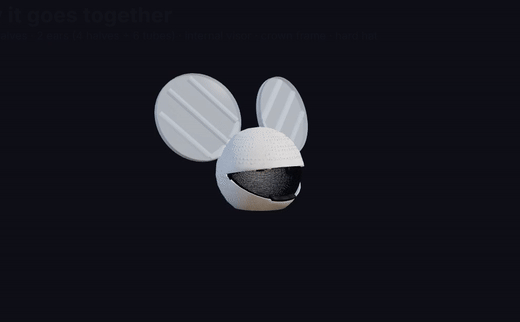
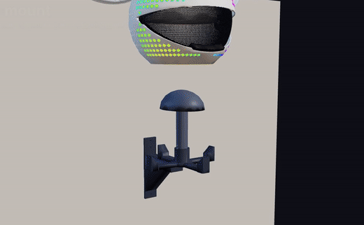

# Building the helmet

How the printed parts, tubes, magnets and hardware go together, in the order that works.
The parts and hardware lists are in [`cad/README.md`](../cad/README.md); why each part is
shaped the way it is, in [`cad-design.md`](cad-design.md). The LEDs and software are in the
main [README](../README.md).

Tools: soldering iron with a 10-32 / M5 heat-set tip, 5/32" hex key, step drill or 1/2" bit,
fine saw for the polycarbonate tube, CA glue, E6000 (or clear silicone), modelling clay.

## 1. Inserts first

Every heat-set insert goes in before anything is joined, while the part can lie flat
under the iron. Push to flush, square, and let it cool before it moves.

| Part | Inserts | Where |
|---|---|---|
| shell top half | 4 + 6 + 2 | the 4 crown bosses inside the top; the top pilot of each seam pad; the end of each visor pivot pin |
| shell bottom half | 6 + 2 | the bottom pilot of each seam pad; the 2 tray bosses low at the back |
| each ear bottom half | 4 | two on each wide face of the peg |
| crown frame | 4 | the 4 hat pads, from below |
| wall bracket | 2 | the arm's top face |

## 2. Visor (into the top half, before the shell is closed)

The visor lives inside the shell and pivots on two Ø12 pins that grow inward from the shell
at ±X.

1. Snap the designed supports off the top half (separate bodies with a 0.25 mm gap, so they
   come away clean).
2. Glue the 6 × 3 mm magnets: two in the visor's pads (top corners), and four in the shell's
   bosses: the lower pair holds it shut, the upper pair holds it open. Check polarity with a
   loose magnet before the glue goes on: each visor magnet must attract both shell magnets
   on its side.
3. Fit the visor before the two shell halves are joined, working in the top half (both
   pins are in it). Each pin stands 13.5 mm proud of its collar, so the visor has to be
   bowed slightly to get its Ø40 pads over the pin ends. Warm the pad areas with a hair dryer
   first, bow it gently from the middle, and let each pad drop over its pin. This is the
   moment it is most likely to crack, and the v14 hubs and rims are there for it.
4. Put a pivot cap over each pin end (the pocket fits over the pin) and screw it into the
   pin's insert with a 10-32 × 3/8". The cap sits 0.3 mm off the pad: the visor turns
   freely but can't walk off the pin.
5. It swings 0–40°. The grab lip under the mouth stops it closed; it stops on the shell at
   about 43° open.

## 3. Closing the shell

1. Cut 12 stubs of 1.75 mm filament, 16 mm long. Push one into each stub hole along the seam
   pads of the bottom half.
2. With the visor on its pins, fit the halves together on the stubs, check the LED grooves line up across the seam,
   then bolt one seam plate across each pad with two 10-32 × 3/8". The strip runs through
   the slot in the pad under the plate.
3. CA the seam outside the pads if you want it permanent. The plates alone hold it.

## 4. Ears

Each ear is two printed halves held together by three clear polycarbonate tubes that run
across the joint (an earlier ear broke along its layer lines; the tubes carry the load).

1. **Cut the tubes** (1" OD × 3/4" ID): per ear, one centre tube **13 3/8"** and two side tubes
   **9 3/4"**. One 36" tube makes one ear's set. They are cut 1/8" short of the bores on purpose.
2. **Blades:** slide the two back-to-back LED strips and a roll of diffusion film into each
   tube. Solder the leads and crimp the JST on **before** anything goes into the ear.
3. **Wire path** (bottom half): from the foot of each side tube a tall open window drops
   through to the hidden underside of the ear; lay the lead into the groove along the
   underside and then into the open slot down the outside of the peg. Only a 5 mm bridge over
   the lit rim is closed. The centre tube's leads go straight down its own bore.
4. Put the tubes into the bottom half, then press the top half down over them. Glue the
   halves (CA) if you like; the tubes keep them aligned either way.
5. **Rim strip:** the 1/16"-deep channel around the edge takes a 10 mm strip; its leads go
   into the head through the holes in the shell at the two ends of the rim.

## 5. Ears onto the head

1. The peg goes 32 mm into the socket inside the shell. The floor of each socket has a Ø20
   hole under the centre tube and two 7 mm wire holes.
2. Either **step-drill the two 7 mm floor holes to 1/2"** so the JSTs pass into the helmet,
   or plug the JST pair together inside the peg's slot and feed only bare wire through the
   7 mm hole. Both work; drilling is easier to service.
3. Lay the leads in the peg slot, push the ear home, and bolt it through the socket walls
   with four 10-32 × 1/2" into the peg's inserts.

## 6. Hard hat (3M SecureFit H-700)

The hat hangs from a crown frame that bolts to the 4 bosses inside the top of the shell.
The 3M hat rides higher on the head than the hat the shell was first sized for, so its
height is set at assembly with spacer stacks instead of being guessed in CAD.

1. Bolt the frame to the shell bosses: four 10-32 × 3/8" from underneath (the frame's
   recesses take the heads). Do this before the hat goes in; you need the room.
2. Tape the flexible drill template to the top of the hat: centre hole on the top centre,
   arrow to the front. Mark the 4 holes and drill them 1/4". A hole that lands on a vent is
   fine: the fender washer inside the hat spans it.
3. **Find the stack heights:** press a ball of modelling clay onto each frame pad. Put the
   hat on your head, put the helmet on in its right position (eyes level with the visor) and
   press down gently. Take it off and measure how thin each ball got.
4. Pick spacers for each pad (2 / 4 / 8 / 16 mm, one of each per pad covers 0–30 mm). Use
   foam tape for the odd millimetre.
5. From inside the hat: fender washer → hat → spacers → pad insert, with a 10-32 about
   stack + 10 mm long.
6. If the hat sits too high, the SecureFit suspension has a lower height setting.
7. Cut clearance holes in the hat shell wherever it touches the ear sockets.

## 7. Electronics tray

The tray bolts to the two bosses low at the back with two 10-32 × 3/8". The GX16 power jack
goes in the 16 mm hole beside it. The controller, fuse and wiring are covered in the main
README.

## 8. Wall mount

Holds the helmet two ways at once: four felt-lined pads cup the outside of the shell just
above the neck, and a head-form dome on a post goes up inside and takes the hard hat's
suspension the way your head does. The pads stop it sliding; the dome stops it tipping.

1. **Bracket:** three #10 × 2½" wood screws into one stud, in the countersunk holes. The arm
   points straight out. Level it.
2. **Cradle:** stick felt on the four pads. Set the cradle on the arm, back spoke along the
   arm, and bolt it with two 10-32 × 5/8" into the arm's inserts.
3. **Post:** drop it into the cradle's socket and pin it with the 1/4" bolt through the middle
   hole (the nominal height). Push the dome onto the top of the post.
4. **Helmet:** lower it straight down over the dome until the shell sits on all four pads.
   If the shell lands on the dome before the pads, move the pin down a hole; if the hat
   doesn't touch the dome, move it up. Each hole is 10 mm.

The pads clear the bottom row of LED windows and the GX16 jack, and the helmet's back sits
28 mm off the wall.
