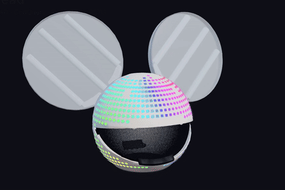
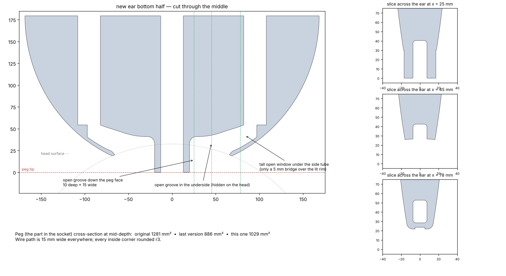
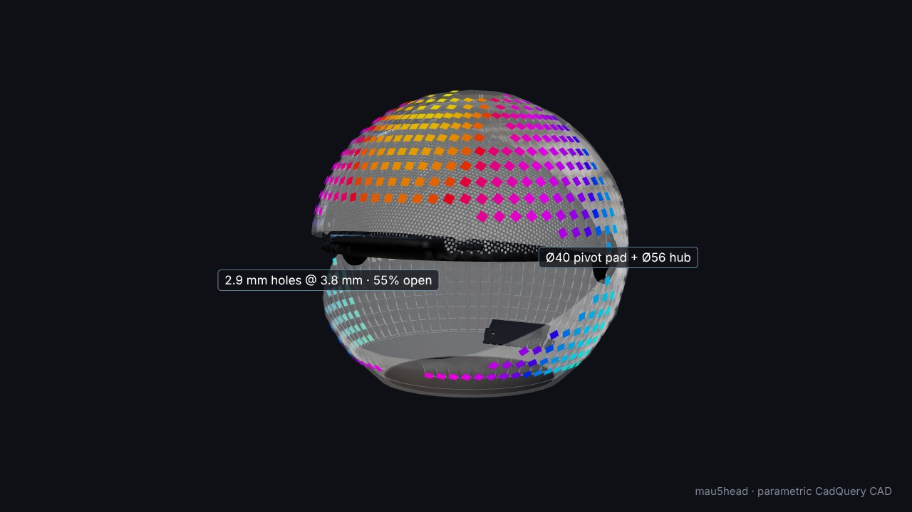
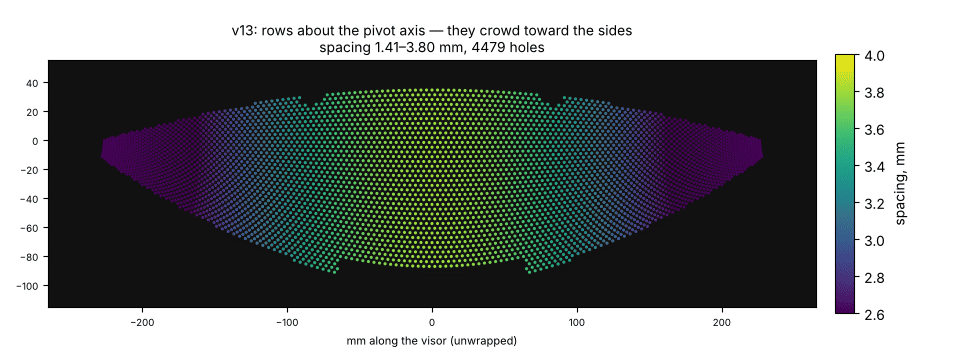
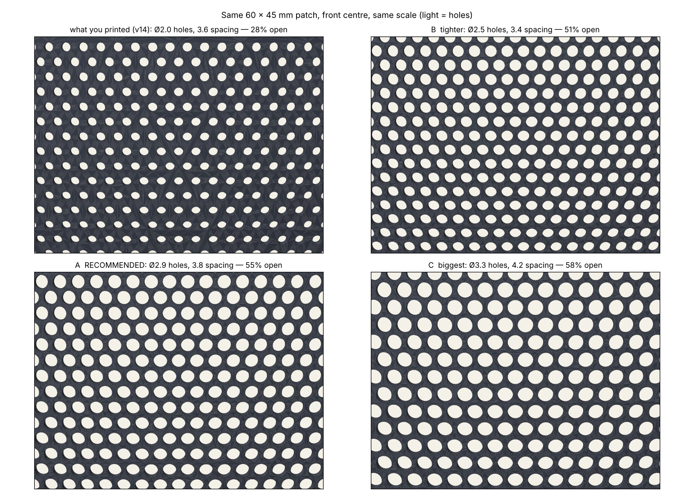
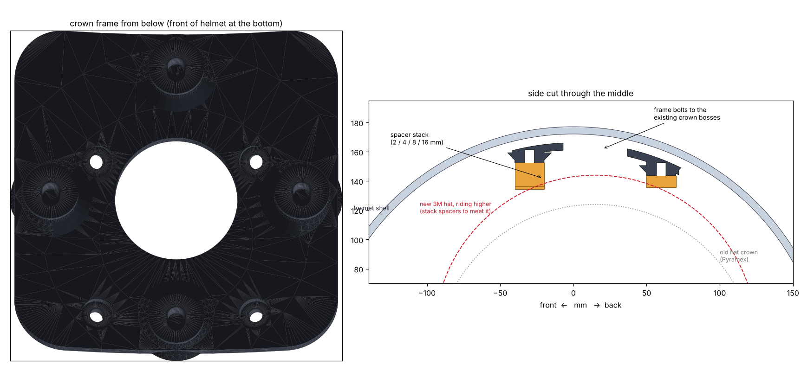
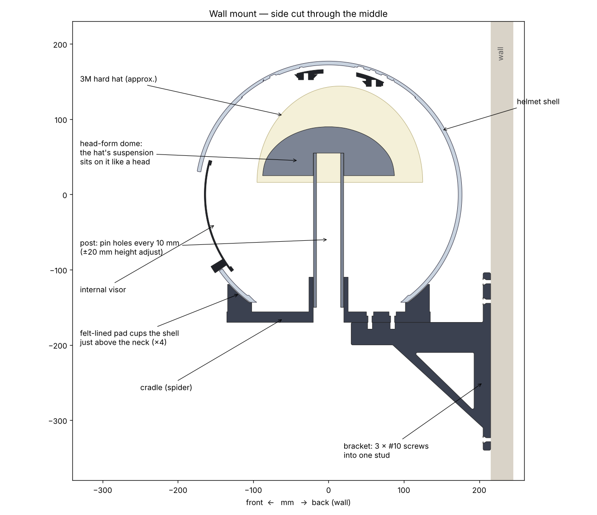

# How the helmet was designed

The helmet is one Python file, [`cad/source/mau5head_hat.py`](../cad/source/mau5head_hat.py),
written with [CadQuery](https://cadquery.readthedocs.io/) (OpenCascade underneath). It builds
every part as a solid, checks them against each other, and writes STEP files. Nothing was
drawn by hand. This page is the story of why it is shaped the way it is: the decisions, the
mistakes, and how each was caught. To print and assemble it, see [`build-guide.md`](build-guide.md).

**The film:** `mau5head_cad_tour.mp4` (40 s: turntable, exploded view, visor, wall mount) is
attached to the GitHub release *CAD v18*.

## Why code instead of a CAD program

- **Every number is a knob.** The shell radius, LED pitch, wall, the ear angle, the visor's
  hole size: about 150 named parameters at the top of the file. "Make the ears thicker" or
  "move the LEDs up a row" is a one-line change and a 90-second rebuild of every part.
- **Repetition is free.** 948 LED windows, 114 groove runs and 3,000+ visor holes are loops,
  not patterns to maintain.
- **Checks are code too.** After every change, the parts are intersected with each other
  (shell vs visor at every swing angle, ears vs hat, wall mount vs helmet) and the
  interference volume printed. Zero means it fits. That caught most of the mistakes below
  before anything was printed.
- **STEP out.** The results open in Onshape, Fusion and PrusaSlicer like any other part.

The frame for everything: origin at the sphere's centre, +Z up, −Y the face, ±X the visor's
pivot axis, millimetres.

## The shell

A sphere of 354 mm outside diameter (measured off the original helmet file), 5 mm wall, cut
flat at the neck.

**The LED grid comes from the strip, not the sphere.** WS2815 at 60 LEDs/m is a 16.67 mm
pitch, so the grid is 68 vertical channels (one strip each, 16.4 mm apart at the equator)
with rows every 16.67 mm *of arc*: every LED sits exactly where the strip puts it, with no
stretching. Meridians converge toward the top, so the channels thin out in tiers: all of
them up to 55°, every second one to 65°, every fourth to 76°, and above that a bare cap
where the hard-hat mount lives.

**Each LED gets a window.** The strip lies in a groove on the inside; at each LED a square
pocket goes almost through the wall and leaves a 2 mm skin, which is 4–5 perimeters of PETG
and glows evenly. The first version's skin was too thin to slice as solid perimeters; the
asserts at the top of the file now refuse any combination of wall, groove and skin that
leaves less than 2 mm anywhere.

**Two halves, designed supports.** The shell is split just below the equator so each half
fits the Prusa XL. The top half prints crown-up on its cut face, over a set of thin-walled
breakaway columns the generator draws under every overhang (crown bosses, ear sockets,
pivot collars), each stopping 0.25 mm short so it snaps off. The halves are aligned by
filament stubs and bolted through six pads on the inside of the seam, each with a slot so
the LED strip passes straight through.

**The neck** has a 45° conical light baffle, so the glow doesn't leak out under your chin
and nothing outside lights your face.

## The ears

Big, round, clear-PETG discs with three "lightsaber" blades inside each: back-to-back LED
strips in clear 1" polycarbonate tubes, plus a strip around the rim.

- **Angle:** on the original helmet's socket axis, measured from its file: the ear's peg is
  the shell's surface normal at that point.
- **Thickness:** a lens shape, 60 mm at the centre and 26 mm at the rim.
- **Strength:** the first printed ear snapped along its layer lines. The fix was to make the
  three tubes structural: they run the full height of the ear, across the joint between the
  two printed halves and across every layer line, into bores in both halves.
- **Mounting:** a 60 × 34 × 32 mm peg goes into a socket inside the shell and is bolted
  through the socket walls with four 10-32s into heat-set inserts. Nothing sticks out.
- **Wiring (v15–v17):** the blade leads first went through 7 mm holes and grooves that had to
  be drilled out. Version 15 made it a JST-sized tunnel; version 16 opened it into grooves you
  lay the wire into; version 17 made it a tall open window under each side tube, open
  grooves in the hidden faces, rounded corners, and a thicker peg. The only closed part left
  is a 5 mm bridge over the lit rim. Every change was checked against the parts already
  printed (same split face, same bores, same peg and insert positions) so only the bottom
  half needed reprinting.

## The visor

The mouth is a slot cut through the shell. Behind it sits an internal visor, a band of a
smaller sphere (R165, 2 mm thick) that pivots on two Ø12 pins growing inward from the shell at
the ear-to-ear axis. It swings up 40° to open. Magnets hold it shut and hold it open, and a
grab lip under the mouth lets you flip it.

**The visor had LEDs, then didn't (v13).** Earlier versions carried LED strips in light-pipe
troughs along the visor's top and bottom edges. They were dropped in the build, so v13 took
the troughs and wire holes out, and filled the shell's matching holes.

**The holes.** The perforation is what lets you see out while people can't see in:

- *Making them.* Cutting 3,600 cylinders out of the B-rep was slow and made a 240 MB STEP.
  Instead, `visor_perforate.py` tessellates the solid visor once and subtracts all the
  cylinders in a single [manifold3d](https://github.com/elalish/manifold) mesh boolean:
  about 10 seconds, watertight output.
- *The spacing bug.* The first field was a hex grid laid out in angles about the pivot axis.
  But the visor is a lune that narrows to a point at each pivot, and those rows converge:
  3.8 mm apart in the middle, 2.7 mm at the sides, with 0.6 mm webs that printed as goop. It
  also stopped 90 mm short of each side for strength.
- *The fix.* Rows of constant latitude about the vertical axis, which never converge across
  the visor, then a short repulsion pass that pushes any two holes closer than the target
  apart. It removes the shear that builds up between rows toward the sides. Spacing is now
  within 5 % everywhere, right out to the pivots:

- *Seeing out.* At the original's spacing (Ø2.0 holes, 28 % open) you couldn't see through
  the print: 2 mm holes in a 2 mm panel are tunnels, and PETG strings across them. The
  recommended pattern is 2.9 mm holes at 3.8 mm (55 % open, 0.85 mm webs), close to the
  ~50 % of one-way window film. That works for the same reason: a dark inside and a bright
  outside. Print it in black.

**The pivots (v14).** The visor cracked around the pivots: its pad joined the panel only
through the narrow pointed tip of the lune. Now each pivot has a Ø40 × 10.7 mm pad on a
Ø56 × 4 mm hub disc that goes all the way round the pivot. Because the disc is symmetric about
the axis, it never sweeps into anything as the visor turns. Constant-width 4 mm rims along
both long edges carry the load into the hubs. The old pivot cap was a disc with a screw
hole that couldn't fit over the pin, so it captured nothing. The new one has a pocket that
seats on the pin end and holds the pad with 0.3 mm of float. All of it was checked at 0°, −10°,
−20°, −30°, −40° and the two stops.

## The hard-hat mount

The helmet weighs about 4.5 kg. It rides on a construction hard hat bolted inside the crown,
so the weight goes through the hat's suspension instead of the shell sitting on your head.

- **v11** used a curved crown plate on the shell's four crown bosses, with four standoffs down
  to a Pyramex cap. A bug: the standoffs sat directly under the bolts into the shell, covering
  their heads.
- **v18** is for a 3M SecureFit H-700, which rides noticeably higher, by an amount nobody
  publishes. So the height is no longer guessed. A frame bolts to the same bosses, with an
  open centre the hat's crown can rise into. The hat hangs from four pads in a diamond
  45 mm around the crown, placed clear of the shell bolts. Stacks of 2/4/8/16 mm spacers
  fill whatever gap there is, set with a ball of clay on each pad. A flexible drill template
  marks the hat.

## The wall mount

`cad/source/wall_mount.py`. It holds the helmet in two places at once:

- **The rim:** a four-armed cradle with concave pads cut from the shell's own sphere (+1 mm of
  felt). They cup the outside just above the neck, between the bottom row of LED windows and
  the neck cut, and clear the GX16 power jack. The cut-out is made with the helmet's whole
  envelope above the neck, so it fits even if the neck was trimmed higher by hand.
- **The centre:** a post up through the neck opening to a head-form dome (140 × 175 mm, small
  enough to pass the 165 × 195 neck hole). The hard hat's suspension rests on it as it rests
  on your head. A 1/4" pin through holes every 10 mm sets its height ±20 mm.
- **The bracket:** wall plate, arm and gusset in one Y-Z profile, printed on its side so no
  layer line runs across the load. Three #10 screws go into one stud, all reachable from
  the front.

Checked against the helmet CAD: zero interference with the shell, visor, ears and the GX16
plug; pads within the felt gap of the shell; the helmet's back 28 mm off the wall.

## Tools

| | |
|---|---|
| CadQuery 2.8 / OpenCascade | every solid, the booleans, STEP export, interference checks |
| trimesh + manifold3d | visor perforation, mesh checks, 3MF |
| numpy + scipy | the LED grid, hex relaxation (k-d tree neighbours) |
| matplotlib | the section drawings and spacing maps |
| three.js + Playwright (headless Chromium) + ffmpeg | the renders and the film (`cad/render/`) |

## Things learned the hard way

- **Check from the side.** Most fit problems showed up in a cut through the middle, never
  in a pretty render. Every change got a section drawing.
- **A pattern on a sphere is never uniform for free.** Any grid in angles converges
  somewhere. Measure the spacing you actually produced, everywhere, not the spacing you asked for.
- **Print orientation is a design decision.** The ears broke on layer lines until something
  crossed them; the wall bracket prints on its side for the same reason.
- **Don't guess what can be set at assembly.** The hat's height and the wall mount's dome
  height are adjustable because no published number existed.
- **Change only what has to be reprinted.** The ear wire fix, the visor and the hat frame
  were all designed to the interfaces of parts already printed.
